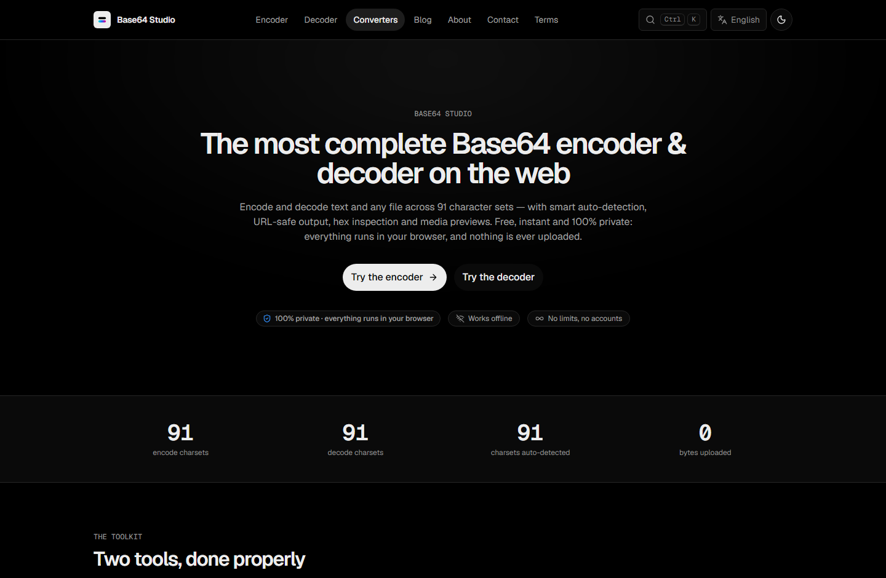
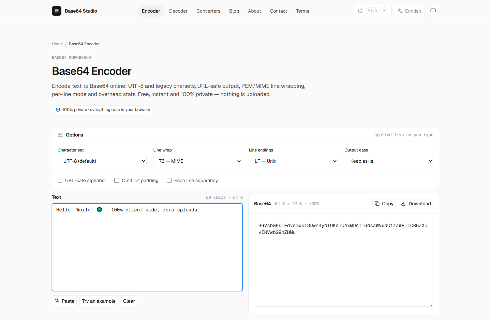
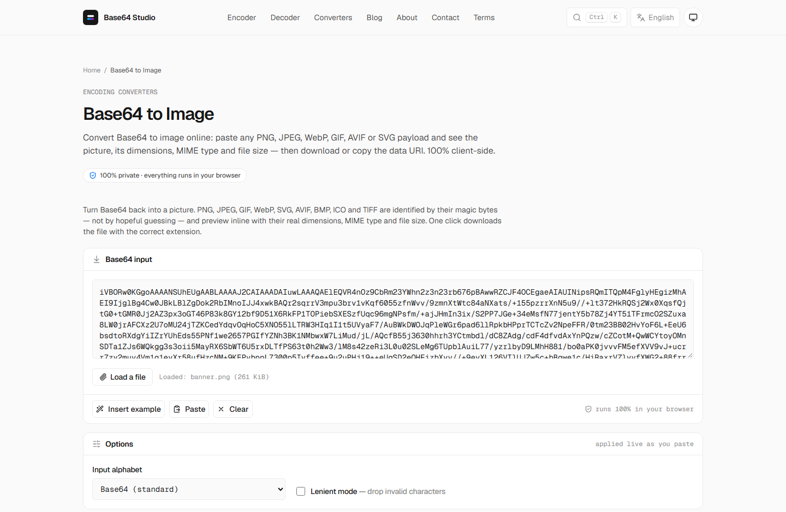
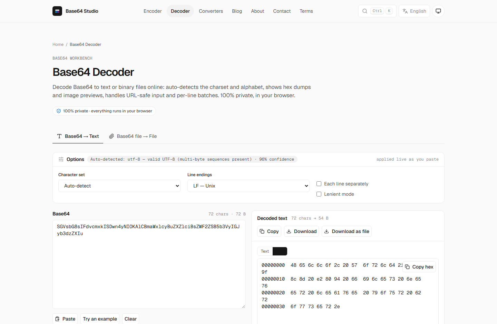
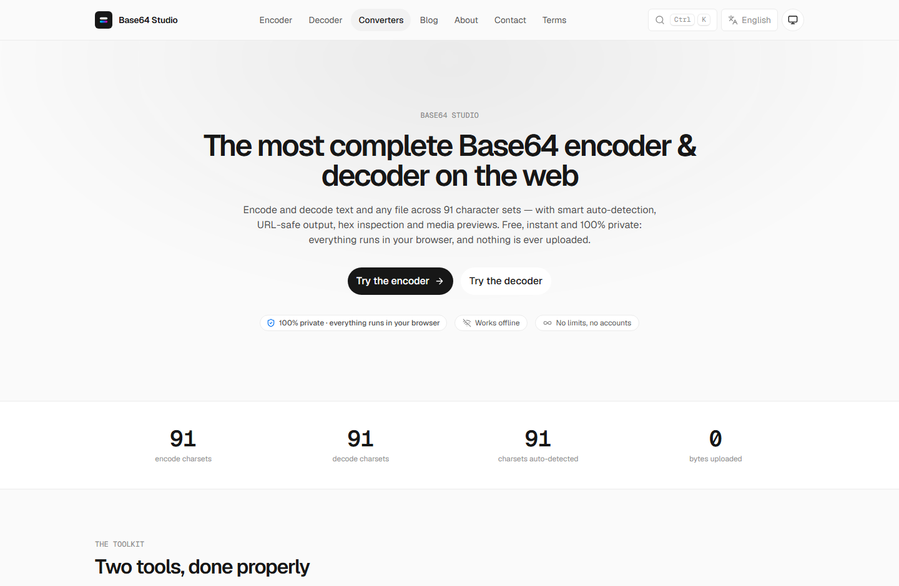

# 🔐 Base64 Studio

**25 developer tools for Base64 & encoding — 100% client-side. Your files never leave your browser.**

🔗 **Live at [base64studio.com](https://base64studio.com)** · Free · No signup · Works offline



---

## Why I built this

Every "paste your file" Base64 converter I found worked the same way: your data hits
their API, their server decodes it, and serves it back. Fine for a text snippet — not
fine for sensitive files or anything large.

Base64 Studio has **no server-side processing at all**. Encoding, decoding, file
previews — everything runs in your browser. Open devtools and watch the network tab
while you use any tool: silence. Disconnect from the internet entirely and the tools
keep working, because they never depended on one.

| | |
|:---:|:---:|
|  |  |
| **Encoder** — 91 charsets, URL-safe, line wrapping | **Base64 → Image** — magic-byte detection, instant preview |

| | |
|:---:|:---:|
|  |  |
| **Decoder** — byte-level hex view for non-text payloads | **10 languages** — EN ES JA FR DE PT KO IT ZH HI |

## The tools

| Category | Tools |
|---|---|
| **Core** | Base64 Encoder · Base64 Decoder (auto-detect, hex view, per-line mode) |
| **Base64 → files** | Image · PDF · Audio · Video · Binary · Text · Hex · JSON · File |
| **Files → Base64** | Text · File · Image · PDF · URL / Data URI |
| **Converters** | Base64 ↔ Base32 · Base58 · Base85 / ASCII85 · Z85 · Hex · Binary · JSON · URL-safe |
| **Extras** | JWT Inspector (Web Crypto signature verification) · Base64 Size Calculator |
| **Languages** | Full UI in 10 languages: EN · ES · JA · FR · DE · PT · KO · IT · ZH · HI |

No signup. No limits. No "upgrade to pro". Works offline.

## Under the hood

- **Static Astro + hand-written TypeScript** — no framework, no hydration
- **Web Workers** for large payloads — the main thread never blocks
- **WHATWG Encoding Standard tables** — single-byte, CJK, EBCDIC, and a composing
  Windows-1258 encoder for Vietnamese; charset tables lazy-load so pages stay light
- **Precise decode errors** — which character failed, at which position, and why
- **UTF-8-correct round trips** — `btoa()` alone breaks on Unicode; this doesn't

```ts
// excerpt from the shared encode/decode core (src/lib/base64.ts)
//
// Guarantees:
//  - UTF-8 correct: "hǸllo 🌍" round-trips exactly (btoa alone does not)
//  - URL-safe mode (RFC 4648 §5): "-_" alphabet, padding stripped
//  - Decoding auto-detects URL-safe input and tolerates line breaks
//  - Errors are precise: which character, at which position, and why
```

Deployed as a static site on Cloudflare's edge network.

## Is my data really private?

Yes — with one honest disclosure: the site uses plain Google Analytics for
anonymous traffic statistics (page views). Your *input data* — text, files,
tokens — is never transmitted anywhere. The [privacy page](https://base64studio.com/privacy)
spells out exactly what is and isn't collected.

## Feedback & issues

Found a charset edge case that breaks? A file format that misbehaves?
[Open an issue](../../issues/new) — a concrete failing input + expected output is
gold, and fixes usually ship fast.

**⭐ If a tool saved you time, a star helps other developers find it.**

## License

All rights reserved. This repository is a project showcase — the application
itself is served at [base64studio.com](https://base64studio.com).
